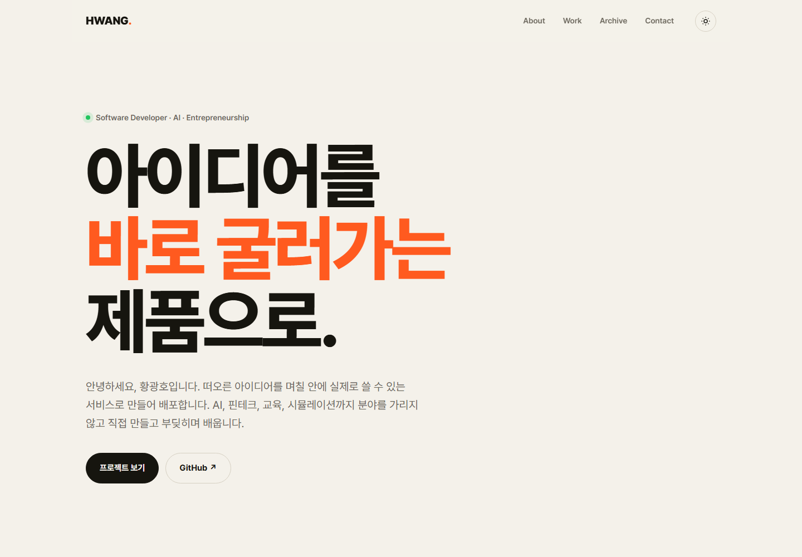

<div align="center">

# HWANG<span>.</span>

**Software Developer · AI · Entrepreneurship**

아이디어를 바로 굴러가는 제품으로.

[](https://hwang9170.github.io/)
[](https://github.com/Hwang9170/Hwang9170.github.io/actions/workflows/pages-deploy.yml)
[](https://github.com/Hwang9170)

<br />

<a href="https://hwang9170.github.io/">
  <picture>
    <source media="(prefers-color-scheme: dark)" srcset="assets/preview-dark.png" />
    
  </picture>
</a>

### [👉 사이트 바로가기](https://hwang9170.github.io/)

</div>

<br />

## 소개

안녕하세요, 황광호입니다. 떠오른 아이디어를 며칠 안에 실제로 쓸 수 있는 서비스로 만들어 배포합니다.
이 저장소는 제 포트폴리오 사이트의 소스 코드입니다.

## 구성

| 섹션 | 내용 |
| --- | --- |
| **Hero** | 한 줄 소개, 저장소 수 · 배포 수 통계 (GitHub에서 실시간 반영) |
| **About** | 소개와 기술 스택 |
| **Selected Work** | 대표 프로젝트 모음, 분야별 필터 (AI / Edu / Fintech / Product) |
| **Archive** | GitHub 전체 저장소를 실시간으로 불러와 검색, 데모 있는 것만 보기 |
| **Contact** | GitHub, CV, Instagram |

라이트·다크 테마(시스템 설정 자동 + 버튼 전환), 모바일 반응형, 스크롤 애니메이션을 지원합니다.

## 대표 프로젝트

| 프로젝트 | 설명 | 링크 |
| --- | --- | --- |
| **모두의 IT** | 매일 IT·AI 뉴스 5개를 카드뉴스로 자동 발행 | [Live](https://hwang9170.github.io/it_4_all/) · [Code](https://github.com/Hwang9170/it_4_all) |
| **RADR 3D Training** | 활주로 피해복구 3D 교육용 시뮬레이션 | [Live](https://radr-training.vercel.app) · [Code](https://github.com/Hwang9170/91_P) |
| **Black-Scholes Model** | 블랙-숄즈 옵션 가격 계산기 | [Live](https://black-scholes-model-by-hwang.vercel.app/) · [Code](https://github.com/Hwang9170/Black-Scholes-model) |
| **금융범죄 예방 학습 앱** | 보이스피싱 범죄 예방 학습 애플리케이션 | [Live](https://app2-blond.vercel.app) · [Code](https://github.com/Hwang9170/app2) |

전체 목록은 [사이트](https://hwang9170.github.io/#work)에서 볼 수 있습니다.

## 기술

- **HTML · CSS · Vanilla JavaScript**: 프레임워크, 빌드 도구 없음
- **GitHub REST API**: Archive 섹션과 통계 실시간 반영
- **GitHub Pages + GitHub Actions**: `main`에 push하면 자동 배포
- 폰트 [Pretendard](https://github.com/orioncactus/pretendard)

## 폴더 구조

```
.
├── index.html              페이지 구조
├── 404.html                404 페이지
├── assets/
│   ├── style.css           디자인 · 테마 토큰
│   ├── main.js             필터, GitHub 연동, 애니메이션
│   ├── projects.js         ← 대표 프로젝트 데이터 (여기만 고치면 Work 섹션 변경)
│   ├── favicon.svg
│   └── preview-*.png       README 미리보기
└── .github/workflows/
    └── pages-deploy.yml    자동 배포
```

## 수정 · 실행

**프로젝트 추가하기**: `assets/projects.js`에 항목을 하나 추가합니다.

```js
{
  title: '프로젝트 이름',
  repo: 'github-repo-name',
  category: 'AI',            // AI | Edu | Fintech | Product (새 값을 쓰면 필터가 자동 추가됨)
  year: 2026,
  desc: '한두 줄 설명',
  tags: ['TypeScript', 'LLM'],
  demo: 'https://...',
  featured: true,            // 크게 보여줄 카드 (선택)
},
```

**로컬에서 보기**

```bash
python -m http.server 8000
# → http://localhost:8000
```

---

<div align="center">

© 2026 Hwang · [GitHub](https://github.com/Hwang9170) · [CV](https://hwang0415.vercel.app/CV.pdf)

</div>
